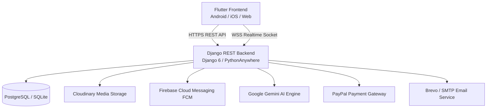

# ProFinder — Professional Services Marketplace

> An end-to-end global marketplace connecting customers with verified professionals across healthcare, legal, engineering, education, and home services. Features real-time WebSocket messaging, AI-powered discovery, automated translation across 6 languages, flexible subscription tiers, and production-hardened transaction security.

---

## Architecture Overview



1. **[Flutter Frontend (`frontend/profinder_app/`)](frontend/profinder_app/README.md)**:
   - Built with Flutter 3.x & Dart.
   - Clean, feature-first architecture (`core/`, `features/`, `shared/`, `l10n/`).
   - Supports 6 languages (English, Urdu, Arabic, Spanish, French, Hindi) with bi-directional RTL layouts.
   - Real-time chat with text, voice notes, and emoji reactions via WebSockets.
   - Passes static analysis with **0 errors / 0 warnings** and a **100% test pass rate (136 / 136 tests)**.

2. **[Django Backend (`backend/`)](backend/README.md)**:
   - Built with Django 6.x & Django REST Framework (DRF) with ASGI WebSocket routing.
   - JWT authentication (`djangorestframework-simplejwt`) + Google OAuth.
   - 12 modular micro-apps: `users`, `profiles`, `search`, `bookings`, `reviews`, `payments`, `subscriptions`, `notifications`, `messaging`, `ai_engine`, `support`, and `admin_panel`.
   - Google Gemini AI recommendations and automated multilingual content translation.
   - Production-hardened against double-booking concurrency, wallet race conditions, and unverified PayPal captures.
   - Full test suite covering payments, bookings, reviews, messaging, notifications, search, and AI translation (**181+ passing tests**).

---

## Repository Directory Layout

```
ProFinder/
├── README.md                           # Master project documentation (this file)
├── Guide.md                            # Comprehensive viva preparation & architecture guide
├── Installation.md                     # Step-by-step local installation & venv guide
├── admin.md                            # Test credentials for Admin, Customers, and Professionals
├── CLEANUP_REPORT.md                   # Frontend code audit & dead code removal report
│
├── backups/                            # Consolidated safety backups (DB snapshots & source archives, gitignored)
│   ├── data_backup.json                # JSON dump of database fixtures
│   ├── db.sqlite3.bak                  # SQLite baseline backup
│   ├── db.sqlite3.hardening_backup*    # Pre-hardening database snapshot
│   └── frontend_backup_before_cleanup* # Pre-cleanup frontend archive
│
├── frontend/
│   └── profinder_app/                  # Flutter cross-platform mobile & web client
│       ├── README.md                   # Complete frontend documentation & viva guide
│       ├── pubspec.yaml                # Flutter dependencies & assets definition
│       ├── lib/                        # Flutter source code
│       │   ├── app/                    # Routing, navigation guards, and auth gates
│       │   ├── core/                   # Theme tokens, networking (Dio), localization utils
│       │   ├── features/               # Modular features (chat, bookings, search, admin, etc.)
│       │   ├── l10n/                   # Multi-language translation files (.arb)
│       │   └── shared/                 # Universal widgets (cards, headers, banners)
│       └── test/                       # Unit & widget test suite (136 passing tests)
│
└── backend/                            # Django REST Framework backend API
    ├── README.md                       # Complete backend API & model documentation
    ├── manage.py                       # Django CLI entrypoint
    ├── requirements.txt                # Python backend dependencies
    ├── profinder/                      # Django project configuration & ASGI/WSGI
    └── apps/                           # Django micro-apps
        ├── users/                      # Auth, JWT, user roles, email dispatch
        ├── profiles/                   # User & professional portfolios
        ├── search/                     # High-precision search: category isolation, phonetic aliases & typo correction
        ├── bookings/                   # Appointment lifecycle & concurrency guards
        ├── messaging/                  # Real-time WebSocket chat, voice notes & attachments
        ├── reviews/                    # Verified ratings & reviews
        ├── payments/                   # PayPal order capture, wallet ledger, exchange rate cache
        ├── subscriptions/              # Dynamic plans & feature quotas
        ├── notifications/              # In-app feed & FCM push notifications
        ├── ai_engine/                  # Google Gemini AI & multilingual translation engine
        ├── support/                    # Help center & ticket system
        └── admin_panel/                # Audit logs, promo banners, Trust & Safety moderation & appeals
```

---

## User Roles & Capabilities

| Role | Interface | Core Capabilities |
|---|---|---|
| **Guest** | `GuestMainScreen` | Browse popular categories, view verified professional cards, read magazine articles, preview platform. |
| **Customer** | `CustomerHomeScreen` | Natural-language AI search, book appointments, chat in real time, make payments, write reviews. |
| **Professional** | `ProfessionalMainScreen` | Manage booking requests, track earnings & wallet withdrawals, build portfolio, upgrade plan. |
| **Admin** | `AdminMainScreen` | Verify professional portfolios, ban/unban users, review audit logs, manage promo banners, handle moderation & appeals. |

---

## Test Accounts & Credentials

Quick test accounts are available in [admin.md](admin.md):

- **Admin**: `ahsan01@gmail.com` / `@Admin123`
- **Customer**: `customer@profinder.com` / `Test@1234`
- **Doctor**: `dr.ahmed@profinder.com` / `Test@1234`
- **Lawyer**: `adv.fatima@profinder.com` / `Test@1234`
- **Electrician**: `elec.kamran@profinder.com` / `Test@1234`
- *See [admin.md](admin.md) for full credential table across all professions.*

---

## Quick Start Guide

### 1. Backend Setup (Django)

```bash
cd backend
python -m venv venv
source venv/bin/activate    # On Windows: venv\Scripts\activate
pip install -r requirements.txt
python manage.py migrate
python manage.py build_search_index
python manage.py runserver
```
*API will run at `http://127.0.0.1:8000/api/`.*  
*Detailed backend setup instructions: [backend/README.md](backend/README.md).*

### 2. Frontend Setup (Flutter)

```bash
cd frontend/profinder_app
flutter pub get
flutter run
```
*Supports connected Android/iOS devices, emulators, and Chrome.*  
*Detailed frontend setup instructions: [frontend/profinder_app/README.md](frontend/profinder_app/README.md).*

---

## Testing & Quality Assurance

- **Frontend Static Analysis**: `flutter analyze` — **0 issues found** (clean state across all files)
- **Frontend Automated Tests**: `flutter test` — **136 / 136 passed (100%)**
- **Backend Test Suites**:
  ```bash
  python manage.py test apps.payments apps.bookings apps.reviews apps.messaging apps.notifications apps.search apps.ai_engine.tests_translation
  ```
  **181+ tests passed** with zero regressions.
- **Production Hardening**:
  - PayPal server-side order capture verification.
  - Concurrency locks on wallet withdrawals and booking time slots.
  - Strict category isolation and Roman Urdu/Hindi phonetic normalization in search.
  - Centralized multilingual translation cache with background persistence.
