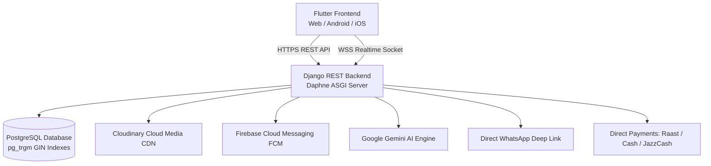

# ProFinder — Pakistan Professional Discovery & Listing Marketplace

> A specialized, Pakistan-focused discovery marketplace connecting customers with verified local professionals (Doctors, Electricians, Tutors, Plumbers, Mechanics, Technicians, Carpenters, and more). Built with a decoupled Flutter cross-platform client and a high-performance Django REST Framework backend running on the Daphne ASGI server with real-time WebSockets, dynamic SEO/web identity, 10 flexible pricing units, and 100% full bilingual (English & Urdu RTL) capability.

---

## Architecture Overview



1. **[Flutter Frontend (`frontend/profinder_app/`)](frontend/profinder_app/README.md)**:
   - Built with Flutter 3.x & Dart with full responsive layout (`ResponsiveUtils`).
   - Clean, feature-first architecture (`app/`, `core/`, `features/`, `l10n/`, `shared/`).
   - 100% Bilingual localization (English and Urdu) with automated RTL directionality and `ContentLocalizer` for live database text.
   - Dynamic Browser Web Identity (`WebMetadataService`): dynamically updates tab titles, favicons, and OpenGraph/JSON-LD metadata on the web.
   - Real-time chat with text, voice notes (.m4a), and typing indicators via persistent WebSockets.
   - Passes static analysis with **0 errors / 0 warnings** across all files.

2. **[Django Backend (`backend/`)](backend/README.md)**:
   - Built with Django 6.x & Django REST Framework (DRF) running on **Daphne ASGI Server**.
   - Stateless JWT authentication (`rest_framework_simplejwt`) + OTP verification.
   - Modular micro-apps: `accounts`, `services`, `inquiries`, `chat`, `reviews`, `notifications`, `support`, and `admin_panel`.
   - High-performance fuzzy search powered by PostgreSQL `pg_trgm` (Trigram) and GIN indexing for typo-tolerant queries.
   - **Service Inquiry & Direct Dealing Business Model**: 0% platform commission; customers and professionals finalize quotes, timing, and payments directly via Cash, Raast, JazzCash, EasyPaisa, or Bank Transfer.
   - Strict sensitive data protection: CNIC numbers and professional licenses are never exposed in public serializers.

---

## User Roles & Capabilities

| Role | Interface | Core Capabilities |
|---|---|---|
| **Guest** | `GuestMainScreen` | Browse categories, view verified cards, read magazine articles, inspect pricing units, preview platform. |
| **Customer** | `CustomerHomeScreen` | Typo-tolerant search, submit Service Inquiries (`Request Service`), chat in real-time, direct WhatsApp contact, write verified reviews. |
| **Professional** | `ProfessionalMainScreen` | Manage incoming service inquiries (accept/decline), configure WhatsApp number, set indicative pricing across 10 units, showcase portfolio. |
| **Admin** | `AdminMainScreen` | Verify professional credentials (CNIC, PMDC/PEC licenses), approve verification badges, monitor user reports, manage promo banners. |

---

## Business & Monetization Model

ProFinder is NOT an e-commerce payment intermediary or escrow service:
- **No In-App Payment Deductions**: ProFinder does not hold funds or deduct transactional cuts from tradespeople or clients.
- **Service Inquiry Model**: Replaces paid bookings with direct appointment requests.
- **Direct Settlement**: Customers pay professionals directly via **Cash on Delivery**, **Raast (instant zero-fee P2P)**, **JazzCash / EasyPaisa**, or **Direct Bank Transfer**.
- **Future Platform Revenue**: Free standard professional listings + premium sponsored placement subscriptions, verified badges, and localized banner advertising.

---

## 📚 Master Documentation & Viva Preparation Hub

Comprehensive project guides, technical basics (Server, Daphne, Middleware, REST APIs, PostgreSQL Trigram, WebSockets, Security), and viva interview preparation are located inside:

📂 **[`C:\Users\Tony  Stark\OneDrive\Desktop\profinder_guide\`](file:///C:/Users/Tony%20%20Stark/OneDrive/Desktop/profinder_guide/README.md)**

### Sequenced Curriculum:
1. `01_PROJECT_ARCHITECTURE_AND_SYSTEM_DESIGN.md` — High-level 3-tier architecture & data lifecycle.
2. `02_BACKEND_SERVER_ASGI_WSGI_AND_DAPHNE.md` — ASGI vs WSGI, Daphne server, event loop concurrency.
3. `03_DJANGO_MIDDLEWARE_AND_REQUEST_LIFECYCLE.md` — Middleware pipeline, CORS preflight, custom middleware.
4. `04_REST_APIS_SERIALIZERS_AND_HTTP_LIFECYCLE.md` — DRF ModelSerializer, ViewSets, HTTP methods & status codes.
5. `05_DATABASE_POSTGRESQL_AND_TRIGRAM_SEARCH.md` — PostgreSQL, `pg_trgm` GIN indexing, `transaction.atomic()`.
6. `06_SECURITY_JWT_AUTHENTICATION_AND_SENSITIVE_PRIVACY.md` — Stateless JWT, PBKDF2 hashing, CNIC privacy guards.
7. `07_REALTIME_CHAT_WEBSOCKETS_AND_CHANNELS.md` — WebSockets persistent sockets, channels consumers, voice notes.
8. `08_SERVICE_INQUIRY_AND_PAKISTAN_DIRECT_DEALING_MODEL.md` — Zero-commission, 10 pricing units, direct payments.
9. `09_DYNAMIC_SEO_GEO_AND_BROWSER_WEB_IDENTITY.md` — Dynamic tab titles, dynamic favicons, DOM conditional imports.
10. `10_URDU_LOCALIZATION_AND_TRANSLATION_SYSTEM.md` — 100% bilingual engine, ARB files, ContentLocalizer, RTL layout.
11. `11_FLUTTER_FRONTEND_ENCYCLOPEDIA.md` — Complete reference of all Flutter widgets, providers, slivers, and layout utilities.
12. `12_PYTHON_DJANGO_BACKEND_ENCYCLOPEDIA.md` — Complete reference of Python & Django concepts, ORM queries, and signals.
13. `13_TOP_35_VIVA_AND_TECHNICAL_INTERVIEW_QUESTIONS.md` — Top 35 Viva exam questions with answers in English and Roman Urdu.

---

## Test Accounts & Credentials

Quick test accounts are available in [admin.md](admin.md):

- **Admin**: `ahsan01@gmail.com` / `@Admin123`
- **Customer**: `customer@profinder.com` / `Test@1234`
- **Doctor**: `dr.ahmed@profinder.com` / `Test@1234`
- **Lawyer**: `adv.fatima@profinder.com` / `Test@1234`
- **Electrician**: `elec.kamran@profinder.com` / `Test@1234`

---

## Quick Start Guide

### 1. Backend Setup (Django + Daphne)

```bash
cd backend
python -m venv venv
venv\Scripts\activate    # On Windows
pip install -r requirements.txt
python manage.py migrate
python manage.py build_search_index

# Run with Daphne ASGI Server
daphne -b 0.0.0.0 -p 8000 core.asgi:application
```
*API runs at `http://127.0.0.1:8000/api/` and WebSockets at `ws://127.0.0.1:8000/ws/`.*

### 2. Frontend Setup (Flutter)

```bash
cd frontend/profinder_app
flutter pub get
flutter gen-l10n

# Run on Web (Chrome)
flutter run -d chrome --web-port=5000

# Or run on Android / iOS
flutter run
```

---

## Quality Assurance & Verification

- **Frontend Static Analysis**: `flutter analyze` — **0 issues found** (clean state across all files).
- **Localization Parity**: 2,197 keys in `app_en.arb` matching 2,197 keys in `app_ur.arb` with **0 untranslated messages**.
- **Responsive Layout**: Button text and icons scale smoothly with `FittedBox` across compact mobile viewports (360px) and wide desktop screens.
