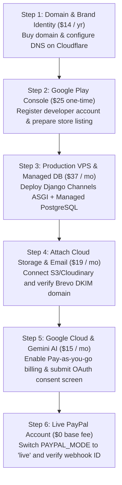

# ProFinder — External Services, Temporary Free Tiers & Production Upgrade Cost Plan

> **Document Type:** Production Readiness & Infrastructure Cost Audit  
> **Target Application:** ProFinder Marketplace (Flutter App + Django REST Backend)  
> **Currency Conversion Baseline:** $1 USD ≈ 280 PKR  
> **Date of Evaluation:** October 2026  

---

## Executive Summary

During the development and testing phase, ProFinder was built using **Free Tiers**, **Developer Sandboxes**, and **Trial Quotas** across all cloud providers. While this allowed zero-cost development, a production launch on the **Google Play Store / Apple App Store** cannot operate on these free accounts due to:
- Strict rate limits (e.g., translation blocking, email daily limits).
- Platform restrictions (e.g., PythonAnywhere free tier does not support real-time WebSockets/ASGI).
- Data privacy requirements (free AI APIs log prompt conversations).
- Branding and security (subdomains, sandbox payment gateways, and unverified OAuth screens).

This document outlines every external service currently in use, its current free limitations, the required production tier, and the projected monthly, annual, and one-time costs in both **USD ($)** and **Pakistani Rupees (PKR)**.

---

## Detailed Service-by-Service Breakdown

---

### 1. Backend Web & WebSocket Hosting

| Parameter | Details |
|---|---|
| **Service Provider** | [PythonAnywhere](https://www.pythonanywhere.com/) (Current) / [DigitalOcean](https://www.digitalocean.com/) (Recommended) |
| **Current Plan** | **Free Beginner Account** (`ahsanrazatalpur.pythonanywhere.com`) |
| **Current Limitations** | • **No ASGI / WebSockets:** PythonAnywhere free tier only runs WSGI; real-time chat via Django Channels cannot maintain live WebSocket connections. • **Outbound Network Whitelist:** Free tier can only make HTTP requests to explicitly whitelisted domains; calls to external APIs frequently fail if not on the whitelist. • **Single Process & CPU Throttling:** Capped at 100 CPU-seconds/day. The web app sleeps and must be manually extended every 3 months. • **No Custom Domain:** Cannot attach a custom SSL domain like `api.profinder.com`. |
| **Production Requirement** | Migrate to a Cloud VPS (e.g., DigitalOcean Droplet, AWS Lightsail, or Railway) running Daphne/Uvicorn to enable real-time WebSocket chat and unconstrained API performance. |
| **Recommended Production Plan** | **DigitalOcean Basic Droplet** (2 GB RAM, 1 vCPU, 50 GB SSD NVMe) |
| **Estimated Cost (USD)** | **$12.00 / month** ($144.00 / year) |
| **Estimated Cost (PKR)** | **Rs. 3,360 / month** (Rs. 40,320 / year) |

---

### 2. Production Database & Redis Caching

| Parameter | Details |
|---|---|
| **Service Provider** | [Neon](https://neon.tech/) / [Supabase](https://supabase.com/) / [DigitalOcean Managed PostgreSQL](https://www.digitalocean.com/products/managed-databases-postgresql) + [Upstash Redis](https://upstash.com/) |
| **Current Plan** | **Local SQLite File (`db.sqlite3`)** on single server |
| **Current Limitations** | • SQLite locks the entire database file during writes (`database is locked` error). High concurrent bookings, wallet withdrawals, or multiple simultaneous logins will cause transaction failures. • No Redis cluster for Django Channels; messaging currently runs on fallback memory layer which cannot scale across multiple workers. |
| **Production Requirement** | Managed PostgreSQL database with automatic daily backups, point-in-time recovery, and an in-memory Redis instance for real-time WebSocket connection routing. |
| **Recommended Production Plan** | **Supabase Pro Tier** (or DigitalOcean Managed DB) + **Upstash Redis Serverless** |
| **Estimated Cost (USD)** | **$25.00 / month** ($300.00 / year) |
| **Estimated Cost (PKR)** | **Rs. 7,000 / month** (Rs. 84,000 / year) |

---

### 3. Google Gemini AI Engine & Multilingual Translation

| Parameter | Details |
|---|---|
| **Service Provider** | [Google Cloud AI Studio / Vertex AI](https://ai.google.dev/) (`google-genai`) |
| **Current Plan** | **Gemini Free Developer Tier** (`gemini-2.5-flash` / `gemini-flash-latest`) |
| **Current Limitations** | • **Strict Rate Limits:** 15 Requests Per Minute (RPM) and 1,500 Requests Per Day. • **Translation Throttled:** In `settings.py`, active translation is currently restricted to only Urdu and Hindi (`['ur', 'hi']`) to avoid hitting the 429 quota exhaustion. Arabic, Spanish, and French dynamic content translation is deferred. • **Data Privacy:** Google reserves the right to use prompts sent via the free API for model training. |
| **Production Requirement** | Google Cloud Pay-As-You-Go Billing (Gemini Paid Tier). Unlocks full 5-language automated translation (`ur`, `hi`, `ar`, `es`, `fr`), zero rate throttling, and customer data privacy guarantees. |
| **Recommended Production Plan** | **Google Cloud Gemini Flash Pay-As-You-Go** (approx. 500,000 tokens/month for search recommendations + translation cache) |
| **Estimated Cost (USD)** | **$15.00 / month** ($180.00 / year) |
| **Estimated Cost (PKR)** | **Rs. 4,200 / month** (Rs. 50,400 / year) |

---

### 4. Cloud Media & Document Storage

| Parameter | Details |
|---|---|
| **Service Provider** | [Cloudinary](https://cloudinary.com/) (Current) or [AWS S3 + CloudFront](https://aws.amazon.com/s3/) (Cost-effective alternative) |
| **Current Plan** | **Cloudinary Free Tier** (`cloud_name: dszlfm6yw`) |
| **Current Limitations** | • Capped at **25 Monthly Credits** (~25 GB net bandwidth / storage). • ProFinder stores user profile photos, high-res professional portfolio samples, legal identity verification documents (CNIC / licenses), chat photos, and voice notes. • Once 25 credits expire, image rendering and file uploads stop immediately across the mobile app. |
| **Production Requirement** | Either upgrade Cloudinary to a paid tier or link an AWS S3 bucket with CloudFront CDN for global distribution. |
| **Recommended Production Plan** | **Option A (Cloudinary Plus):** $89.00 / month *(Expensive)* **Option B (Recommended — AWS S3 + CloudFront):** Pay-as-you-go based on storage & egress (~$10.00 / month for startup scale). |
| **Estimated Cost (USD)** | **$10.00 / month** ($120.00 / year) |
| **Estimated Cost (PKR)** | **Rs. 2,800 / month** (Rs. 33,600 / year) |

---

### 5. Transactional Email Service

| Parameter | Details |
|---|---|
| **Service Provider** | [Brevo](https://www.brevo.com/) (formerly Sendinblue) |
| **Current Plan** | **Brevo Free Plan** (API + SMTP relay) |
| **Current Limitations** | • Strict ceiling of **300 emails per day**. • Free accounts enforce shared sending IPs that may occasionally deliver password-reset emails to the spam/junk folder. • If more than 300 users register or request password resets in 24 hours, email delivery halts. |
| **Production Requirement** | Dedicated transactional email plan with custom domain SPF/DKIM verification for 99%+ inbox placement. |
| **Recommended Production Plan** | **Brevo Starter Tier** (up to 5,000 emails/month) or **Amazon SES** ($0.10 per 1,000 emails) |
| **Estimated Cost (USD)** | **$9.00 / month** ($108.00 / year) |
| **Estimated Cost (PKR)** | **Rs. 2,520 / month** (Rs. 30,240 / year) |

---

### 6. Firebase Cloud Messaging (FCM) & Push Notifications

| Parameter | Details |
|---|---|
| **Service Provider** | [Google Firebase](https://firebase.google.com/) (`firebase-admin`) |
| **Current Plan** | **Firebase Spark Plan (Free)** |
| **Current Limitations** | • Basic FCM push notifications are free without hard caps. • However, production monitoring, Crashlytics, and any serverless Cloud Functions require upgrading the Google Cloud project to the Blaze plan. |
| **Production Requirement** | Upgrade Google Cloud project to **Blaze Plan** (Pay as you go). |
| **Estimated Cost (USD)** | **$0.00 / month** ($0.00 / year) *(FCM push remains free; minimal usage under free quota threshold)* |
| **Estimated Cost (PKR)** | **Rs. 0 / month** (Rs. 0 / year) |

---

### 7. Google OAuth 2.0 (Social Sign-In)

| Parameter | Details |
|---|---|
| **Service Provider** | [Google Cloud Console](https://console.cloud.google.com/) (OAuth Consent Screen) |
| **Current Plan** | **Development / Testing Mode** |
| **Current Limitations** | • Consent screen shows **"Google hasn't verified this app"** warning in red text to new users. • User limit is capped at 100 test users until Google verification is completed. • Requires published Privacy Policy and Terms of Service URLs on a registered domain. |
| **Production Requirement** | Submit OAuth Consent Screen for Google Verification and Brand Approval. |
| **Estimated Cost (USD)** | **$0.00** *(Google does not charge for verification, but requires custom domain & hosting)* |
| **Estimated Cost (PKR)** | **Rs. 0** |

---

### 8. PayPal Payment Gateway & Merchant Account

| Parameter | Details |
|---|---|
| **Service Provider** | [PayPal Developer & Commerce Platform](https://developer.paypal.com/) |
| **Current Plan** | **Sandbox Test Mode** (`PAYPAL_MODE = 'sandbox'`) |
| **Current Limitations** | • Only fake sandbox buyer/seller accounts can make payments. • Live real-world money cannot be transferred, charged, or withdrawn. • Live account requires business verification, bank link, and API keys. |
| **Production Requirement** | Live PayPal Business Account with verified bank account linked for automated payouts. |
| **Estimated Cost (USD)** | **$0.00 / month base fee** (Transaction Fee: **2.99% to 3.49% + $0.49** deducted per payment) |
| **Estimated Cost (PKR)** | **Rs. 0 / month base fee** (Deducted dynamically from transactions) |

---

### 9. Multi-Currency Exchange Rate Engine

| Parameter | Details |
|---|---|
| **Service Provider** | [ExchangeRate-API](https://www.exchangerate-api.com/) / [Open ER-API](https://open.er-api.com/) |
| **Current Plan** | **Free Open Endpoint** (`https://open.er-api.com/v6/latest/USD`) |
| **Current Limitations** | • Rates update once every 24 hours; free public endpoint has no uptime SLA. |
| **Production Requirement** | ProFinder's backend already implements `ExchangeRateCache` in `apps/payments/exchange.py`, which caches rates for 12 hours. The free tier is sufficient for launch; paid tier is only needed if sub-minute live currency trading rates are required. |
| **Recommended Production Plan** | **Free Tier (Retained)** or **Standard Plan ($10.00 / month)** if real-time rates are demanded. |
| **Estimated Cost (USD)** | **$0.00 / month** (Optional: $10.00 / month) |
| **Estimated Cost (PKR)** | **Rs. 0 / month** (Optional: Rs. 2,800 / month) |

---

### 10. Custom Domain Name & SSL Certificate

| Parameter | Details |
|---|---|
| **Service Provider** | [Namecheap](https://www.namecheap.com/) / [Cloudflare](https://www.cloudflare.com/) / [PKNIC](https://pknic.net.pk/) |
| **Current Plan** | **PythonAnywhere Free Subdomain** (`ahsanrazatalpur.pythonanywhere.com`) |
| **Current Limitations** | • Cannot release a commercial mobile app on Play Store using a student/free hosting subdomain. • Required for Google OAuth verification, PayPal webhooks, and SSL trust. |
| **Production Requirement** | Register brand domains (e.g., `profinder.com` or `profinder.pk`) with Cloudflare DNS & free Let's Encrypt SSL. |
| **Estimated Cost (USD)** | **$14.00 / year** (approx. $1.16 / month) |
| **Estimated Cost (PKR)** | **Rs. 3,920 / year** (approx. Rs. 326 / month) |

---

### 11. Mobile App Store Developer Accounts (Play Store & App Store)

| Parameter | Details |
|---|---|
| **Service Provider** | [Google Play Console](https://play.google.com/console) & [Apple Developer Program](https://developer.apple.com/) |
| **Current Plan** | **None** (Tested on physical Android devices & emulators) |
| **Current Limitations** | Cannot distribute the application to real public users via official app stores. |
| **Production Requirement** | Official developer licenses to publish and update the Flutter mobile apps. |
| **Google Play Console (Android)** | **$25.00 one-time fee** (Lifetime access) — **Rs. 7,000 one-time** |
| **Apple Developer Program (iOS)** | **$99.00 / year** (Required annually for iPhone app) — **Rs. 27,720 / year** |

---

## Comprehensive Cost Summary & Budget Options

To help plan the project deployment budget, here are two realistic launch scenarios:

### Option A: Lean Startup Budget (Recommended for Launch)
*Includes: DigitalOcean VPS (WebSockets enabled) + Managed Supabase DB + Gemini AI Flash + AWS S3 Storage + Brevo Email + Domain + Google Play Store.*

| Expense Item | Frequency | Cost (USD) | Cost (PKR) |
|---|---|---|---|
| **Google Play Developer Account** | One-Time | $25.00 | Rs. 7,000 |
| **Custom Domain (`profinder.com`)** | Annual | $14.00 | Rs. 3,920 |
| **VPS Hosting (DigitalOcean / ASGI)** | Monthly | $12.00 | Rs. 3,360 |
| **Managed PostgreSQL Database** | Monthly | $25.00 | Rs. 7,000 |
| **Google Gemini AI (Paid Token Quota)** | Monthly | $15.00 | Rs. 4,200 |
| **AWS S3 Media Storage & CDN** | Monthly | $10.00 | Rs. 2,800 |
| **Brevo Transactional Email** | Monthly | $9.00 | Rs. 2,520 |
| **Firebase Cloud Messaging** | Monthly | $0.00 | Rs. 0 |
| **PayPal Gateway Integration** | Monthly | $0.00 | Rs. 0 |
| **Total One-Time Initial Expense** | **Once** | **$25.00** | **Rs. 7,000** |
| **Total Ongoing Monthly Operating Cost** | **Monthly** | **$71.00** | **Rs. 19,880** |
| **Total Annualized Cost (Year 1)** | **1st Year** | **$891.00** | **Rs. 249,480** |

---

### Option B: Extended Mobile Launch (Android + iOS + Premium Cloudinary)
*Includes everything in Option A plus Apple App Store developer membership ($99/yr) and upgraded enterprise services.*

| Expense Item | Frequency | Cost (USD) | Cost (PKR) |
|---|---|---|---|
| **Google Play Store Developer License** | One-Time | $25.00 | Rs. 7,000 |
| **Apple Developer Program License** | Annual | $99.00 | Rs. 27,720 |
| **Custom Domain (`profinder.com` + `.pk`)** | Annual | $35.00 | Rs. 9,800 |
| **High-Performance VPS Hosting (4GB RAM)** | Monthly | $24.00 | Rs. 6,720 |
| **Managed DB + High Availability Redis** | Monthly | $35.00 | Rs. 9,800 |
| **Google Gemini AI Token Pool** | Monthly | $25.00 | Rs. 7,000 |
| **Media Storage & CDN** | Monthly | $15.00 | Rs. 4,200 |
| **Brevo Email Starter** | Monthly | $9.00 | Rs. 2,520 |
| **Total One-Time Initial Expense** | **Once** | **$25.00** | **Rs. 7,000** |
| **Total Ongoing Monthly Operating Cost** | **Monthly** | **$108.00** | **Rs. 30,240** |
| **Total Annualized Cost (Year 1)** | **1st Year** | **$1,455.00** | **Rs. 407,400** |

---

## Step-by-Step Priority Upgrade Roadmap

When ready to take ProFinder live, follow this recommended sequence to optimize costs:

1. **Phase 1 (Immediate for Beta / Play Store):**
   - Purchase the custom domain name (~$14 / Rs. 3,920).
   - Purchase Google Play Console account ($25 / Rs. 7,000).
   - Migrate backend from PythonAnywhere Free to DigitalOcean VPS ($12 / mo) so that real-time WebSockets work for users.
2. **Phase 2 (Growth & Scaling):**
   - Attach Gemini paid billing ($15 / mo) to unlock all 5 languages for translations.
   - Switch PayPal from Sandbox to Live merchant mode.
   - Attach Apple Developer Program ($99 / yr) when ready to launch on iOS.
